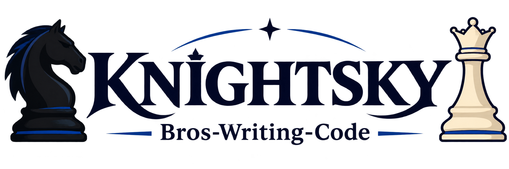

<p align="center">
  
</p>

## Overview

KnightSky is a decentralized chess application built on the AT Protocol. It pairs familiar chess gameplay with decentralized identity and data ownership. Try the live demo at [knightsky.app](https://knightsky.app/).

The project brings together a browser-based chess interface, a pure chess engine, and AT Protocol integration. The UI provides an interactive Chessground board, clocks, legal-move feedback, and local play against a Stockfish bot. The engine validates moves and implements core chess rules, while the AT Protocol layer provides OAuth sign-in and defines the Lexicon schemas for decentralized game data. Automated CI checks test, lint, format, build, and deploy the application.

## Quick Start

Requires Node.js 24 or newer and npm.

```sh
npm install            # Install dependencies
npm test               # Run the test suite
npm run build          # Create a production build
npm run dev            # Start the local development server
```

Vite prints the local URL when the server is ready (normally `http://localhost:5173/`).

## Repository Map

| Directory | Contents |
| --- | --- |
| `src/engine/` | Pure chess rules, game-state operations, move generation, and the public engine API. |
| `src/app/` | Browser UI, including the Chessground demo, game adapter, and clock. |
| `src/atproto/` | AT Protocol OAuth integration and Lexicon definitions for game data. |
| `src/bot/` | Browser-hosted Stockfish opponent adapter and its bundled engine assets. |
| `docs/adr/` | Architecture Decision Records explaining key technical choices. |
| `docs/specs/` | Feature specifications and acceptance details. |

## Documentation

- [Requirements](docs/requirements.md)
- [Ubiquitous Language](docs/ubiquitous_language.md)
- [Architecture Decision Records](docs/adr/)
- [Engine Public API](src/engine/README.md)
- [AT Protocol Integration](src/atproto/README.md)
- [Chessground Demo Specification](docs/specs/chessground-demo.md)

## Team

Adarsh Shetkar (Project Leader), Ali Mohammadiasl, Congke Chen, Edward Loeber, James Keys (Project Leader), Keanu Jahncke, Kenneth Song, Russel Sofia, and Welo Gosline-Niheu.
